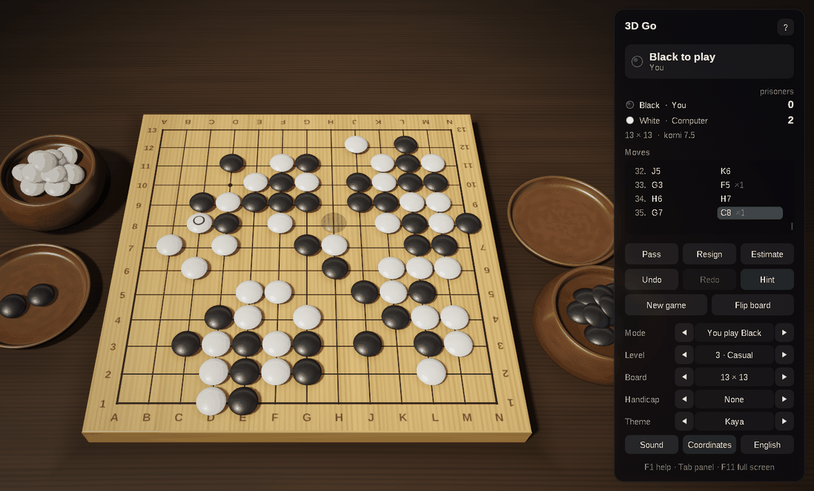
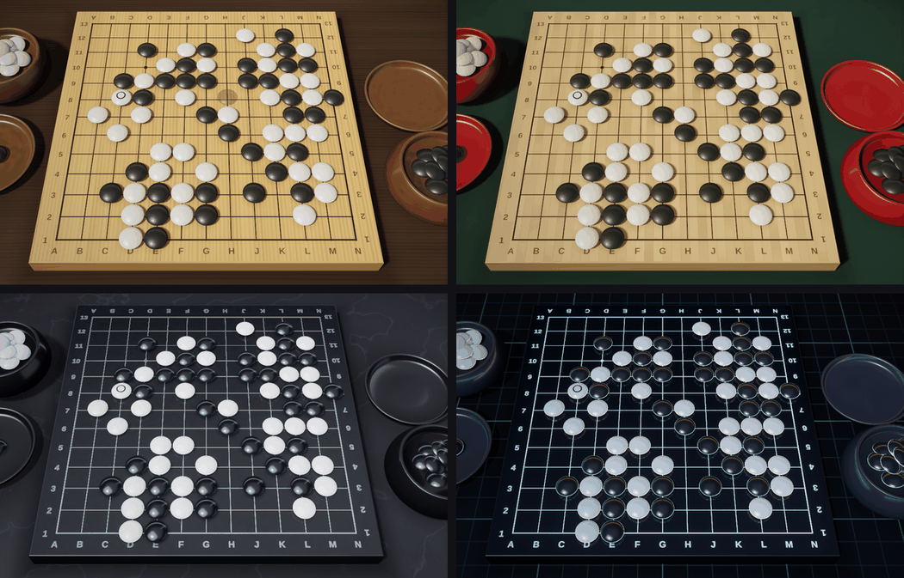

# 3D Go for macOS: Swift and Metal

[](https://github.com/sponsors/makarov-mm)
[](LICENSE)


[](https://www.linkedin.com/in/makarov-mm/)
[](https://www.threads.net/@m.m.makarov)
[](https://www.instagram.com/m.m.makarov/)

A 3D game of Go for the Mac, written in Swift 6 on AppKit and Metal. It is the macOS version of 3D Go for Windows (C++23, Win32 and OpenGL 4.6): the same rules, computer opponent, scene and interface, rewritten for the Mac.

There is no game engine, framework or third-party library, and no model, texture or sound file: the stones, the bowls and their lids are turned on a lathe in code at startup, the wood, slate, shell and glass are procedural, the lighting environment is baked on the GPU, and the sounds are synthesized. The Metal shaders are compiled from source built into the executable, so the application needs nothing beside its icon.





## Features

### Rules

- Boards of 9×9, 13×13 and 19×19, with handicaps of 2 to 9 stones (5 on 9×9) on the usual points
- Captures, the ko rule and positional superko; suicide is not allowed
- Area (Chinese) scoring with komi 7.5, or 0.5 with a handicap; two passes in a row end the game
- Counting: the dead stones are found by the computer and can be corrected with a click on a group; the territory is marked with squares, and the score is kept up to date. The count is accepted, or the game is played on
- Resignation, with a second click to confirm in the panel, or a confirmation from the menu
- The points are named as on a printed board: columns `A`–`T` without `I`, rows from 1 at Black's side

### Play

- A computer opponent with five levels, from Novice to Master: Monte Carlo tree search with RAVE and priors, playouts that answer ataris, take stones, follow 3×3 shapes and leave eyes alone, several threads, and the empty corners first on the big boards. It passes when nothing is left to gain, and resigns a hopeless game. It thinks on threads of its own, so the window stays responsive
- Play Black, play White, two players on one Mac, or watch a demo game
- A see-through stone shows where a click would play; the stones it would take rise a little and glow. A point where ko forbids a retake is marked
- Undo and redo, the move list with the stones each move took, the prisoners of each side
- Hints, with the suggested point ringed; an estimate of the score, with the territory and the stones that look dead shown on the board
- Copy the game as SGF and paste an SGF game to continue it (its main line, with the size, komi, handicap and setup stones)
- The game in progress and the settings are kept between sessions
- English and Russian, chosen from the system language and switched at any time, the menus included
- Sound effects, full screen, the window's place and size remembered

### On the Mac

- A native menu bar with the game's commands and their usual shortcuts, enabled only when they apply
- An About window with what the game is, who made it and where to find him
- Trackpad gestures: pinch to zoom, turn two fingers to turn the board, two-finger scrolling
- Sharp on Retina displays, up to 120 frames a second on ProMotion displays
- The keys work in any keyboard layout, Russian included
- No work while nothing moves: the view stops drawing until something happens, and the game waits while its window cannot be seen

### Graphics

- Physically based shading: GGX highlights, a clear lacquer coat, light passing through thin stone edges, image-based lighting from a procedural studio environment
- Soft shadows (PCSS), the shade round stones on the board and round the feet of the bowls, and the stones reflected in the polished boards
- HDR rendering with 4× MSAA, bloom, ACES tone mapping, vignette and dithering
- Smooth edges everywhere: multisampling for the outlines, and the lines, the hoshi, the coordinates and the marks drawn by the shaders filtered over each pixel; highlights widen where the surface curves within a pixel, so they do not sparkle
- Stones shaped as Japanese stones are cut, both faces domed, drawn hundreds at once with instancing; each has its own grain, so no two look alike
- Animation: a stone rises from the player's bowl and flies to its point, then the stones it takes fly into the lid of the player who took them; a move taken back runs the other way, and a new game dissolves in
- Four themes: Kaya with slate and shell stones, Bamboo with Chinese yunzi stones, Glass, and Neon
- An interface of frosted-glass panels, sharp at any screen scale

## Controls

| Action | Control |
|---|---|
| Place a stone; mark a group dead or alive when counting | Click a point |
| Turn the view | Drag with either mouse button, or turn two fingers on the trackpad |
| Zoom | Scroll, or pinch on the trackpad |
| Take back / replay a move | `⌘Z` / `⇧⌘Z`, `←` / `→`, `Delete` |
| Pass | `P` |
| Hint | `H` |
| Estimate the score | `E` |
| Accept the count | `Return` |
| New game | `N`, `⌘N` |
| Flip the board | `F` |
| View from above | `V` |
| Reset the view | `Home`, or the View menu |
| Computer level | `1` … `5` |
| Who plays whom | `M` (`⇧M` back) |
| Board size | `B` (`⇧B` back) |
| Coordinates on / off | `C` |
| Next theme | `T` (`⇧T` back) |
| Sound on / off | `S` |
| English / Russian | `L` |
| Show / hide the panel | `Tab` |
| Full screen | `⌃⌘F` |
| Copy the game (SGF) | `⌘C` |
| Paste a game (SGF) | `⌘V` |
| Help | `?`, `⌘?` |
| About the game and its author | `A`, the `i` button in the panel, or the application menu |
| Close the help, leave full screen | `Esc` |

The board size and the handicap apply at once to a game not yet begun or already over, and otherwise to the next game.

## Requirements

- macOS 14 Sonoma or later, on Apple silicon or Intel
- Xcode 16 or later, or its Command Line Tools, for Swift 6

## Building and running

```bash
./build.sh          # builds build/3D Go.app
./build.sh run      # builds it and opens it
./build.sh clean    # removes .build and build
```

The script builds the release configuration with the Swift Package Manager, puts the executable into an application bundle with its icon and `Info.plist`, and signs it for the Mac it was built on. The application can then be moved to `/Applications`. To give it to others, sign it with a Developer ID and have it notarized.

The package can also be opened in Xcode (`File › Open…`, then `Package.swift`), or run without a bundle with `swift run -c release`.

The settings and the game in progress are kept in the user defaults, in `~/Library/Preferences/com.makarovmm.go3d.plist`.

## Project structure

```text
.
├── Package.swift
├── build.sh                    builds and signs the application bundle
├── Resources/AppIcon.icns      the icon
└── Sources/Go3D/
    ├── App/                    AppKit: the entry point, the application delegate, the window's Metal view,
    │                           the menus, the About window and its links
    ├── Controller/             the game flow, the computer players, the mouse and the keyboard,
    │                           the panel, the help, the banner and the toasts
    ├── Game/                   the rules: strings and liberties kept move by move, ko and superko, scoring, SGF
    ├── Engine/                 the computer player: Monte Carlo tree search, playouts and the estimate of the score,
    │                           run on threads of their own
    ├── Scene/                  vectors and matrices, the stone turned on a lathe, the meshes of the board, the table,
    │                           the bowls and the lids, the stones and their animation, the orbit camera, the themes
    ├── Render/                 the Metal renderer, the pipelines, the GPU meshes and buffers
    │   └── Shaders/            the Metal Shading Language source, compiled when the game starts
    ├── Interface/              font atlases and the board's coordinates drawn with Core Text, the drawing of
    │                           the interface, English and Russian texts
    └── Platform/               the settings in the user defaults, the synthesized sounds on AVAudioEngine
```

## How a frame is drawn

1. **Shadow map:** the board, the bowls and the stones seen from the key light, for soft shadows; the stones in one instanced draw.
2. **Reflection:** the stones over the board mirrored under it, drawn at half resolution and blurred into mipmaps, so the polish of each theme can show a sharper or softer reflection.
3. **Main pass:** the table, the board, the bowls and the stones in HDR with 4× MSAA, lit by the key light and the baked environment. The lines, the hoshi, the coordinates and the marks of each point (territory, ko, hint) are drawn by the board's shader from a small array of the points; the stones are drawn in one instanced call for each color, and the see-through ones, sorted, last.
4. **Post-processing:** the samples are resolved, bright parts spread into a six-level bloom, and the composite pass applies tone mapping and vignetting and frosts the glass behind the interface panels.
5. **Interface:** panels, text and icons, drawn on top in the same pass.

The environment maps are baked with compute kernels when the theme changes, and the BRDF table once at startup. Up to three frames are in flight; the buffers written every frame rotate among three.

## License

MIT License

Copyright (c) 2026 Mykhailo Makarov

Permission is hereby granted, free of charge, to any person obtaining a copy
of this software and associated documentation files (the "Software"), to deal
in the Software without restriction, including without limitation the rights
to use, copy, modify, merge, publish, distribute, sublicense, and/or sell
copies of the Software, and to permit persons to whom the Software is
furnished to do so, subject to the following conditions:

The above copyright notice and this permission notice shall be included in all
copies or substantial portions of the Software.

THE SOFTWARE IS PROVIDED "AS IS", WITHOUT WARRANTY OF ANY KIND, EXPRESS OR
IMPLIED, INCLUDING BUT NOT LIMITED TO THE WARRANTIES OF MERCHANTABILITY,
FITNESS FOR A PARTICULAR PURPOSE AND NONINFRINGEMENT. IN NO EVENT SHALL THE
AUTHORS OR COPYRIGHT HOLDERS BE LIABLE FOR ANY CLAIM, DAMAGES OR OTHER
LIABILITY, WHETHER IN AN ACTION OF CONTRACT, TORT OR OTHERWISE, ARISING FROM,
OUT OF OR IN CONNECTION WITH THE SOFTWARE OR THE USE OR OTHER DEALINGS IN THE
SOFTWARE.

## Support

If you found this project interesting or useful, you can support my work:

[](https://github.com/sponsors/makarov-mm)
